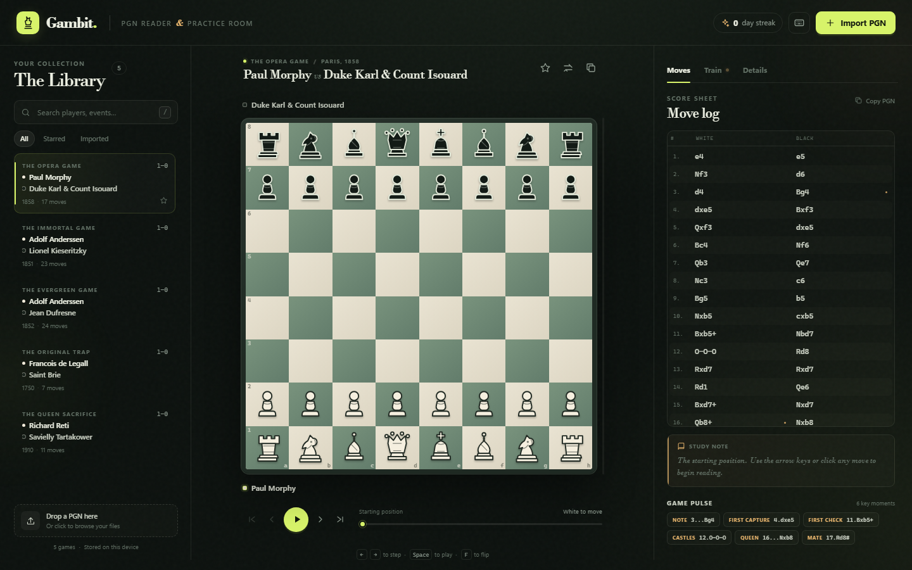

# Gambit

A calm, dependency-free chess workspace for reading PGN games and training recall. Five annotated classics are included so there is something to study the moment it opens.



## Run it

Open `index.html` directly, or serve the folder locally:

```powershell
python -m http.server 8000
```

Then visit `http://127.0.0.1:8000`.

There is no build step, package install or server-side code.

## What is inside

- **PGN reader** — import one game or a whole collection by paste, file picker or drag and drop. Reads headers, comments, annotations, clocks and NAGs. Navigate with the move list, timeline, keyboard or autoplay.
- **Classical library** — the Opera Game, the Immortal Game, the Evergreen Game, Legall's original trap and Réti's queen sacrifice, all with study notes.
- **Guess the move** — take one side, answer with the move actually played, and get feedback, hints, streaks and a session summary. Sessions take their first 10 questions from the selected point.
- **Coordinates** — a 60-second square-finding drill on an empty board, with a personal best and best streak.
- **Reading aids** — study notes, game pulse, factual insights and a copyable PGN.
- **Local by design** — imported games, favorites and training stats stay in `localStorage` on the device.

## Keyboard

| Key | Action |
| --- | --- |
| `←` / `→` | Previous / next move |
| `Home` / `End` | Start / final position |
| `Space` | Play or pause |
| `F` | Flip the board |
| `I` | Import a PGN |
| `/` | Focus library search |
| `?` | Show shortcuts |
| `Esc` | Close a dialog or menu |

## Notes on the training model

Guess the move is a recall drill, not an engine analysis. The expected answer is the move from the score sheet, so an alternative good move is intentionally marked as a miss. Coordinates and game insights are generated locally from the board and PGN.

## Structure

```
index.html        app shell and icon sprite
styles.css        visual system and responsive layout
app.js            reader, library, imports and training UI
js/engine.js      legal move generation, FEN and SAN helpers
js/pgn.js         PGN reader and writer
js/samples.js     bundled annotated games
favicon.svg       mark
```

The historical game scores are public-domain chess notation; the study annotations were written for this project.
